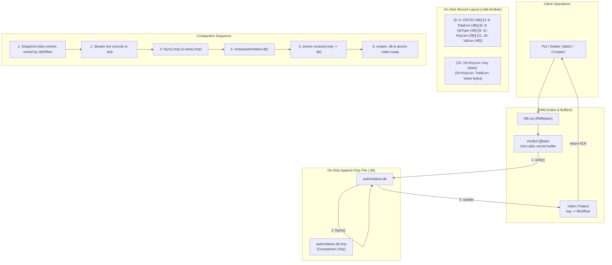

# Architecture & Robustness Proof

## Part 1: Architecture Diagram

### Write Ordering Sequence

1. **Acquire write lock (`db.mu.Lock()`)**: Guards in-memory buffer (`encBuf`) and file append offset.
2. **Encode Record**: `EncodeRecord(encBuf, op, key, val)`. Prepares CRC32 (IEEE) over `hdr[4:15] + key + value`. Total length = 15 + KeyLen + ValLen.
3. **Append to Log (`db.file.Write(encBuf)`)**: Writes record bytes at current `writeOffset`.
4. **Durable Flush (`db.file.Sync()`)**: Invokes OS `fsync` (`FlushFileBuffers` on Windows).
5. **Update Memory Index (`db.index.Set(key, offset)`)**: Updates RAM hash table to point to the new record start.
6. **Advance Write Offset & Release Lock**: Returns success / sends `ACK <op-id>`.

---

## Part 2: Scenario-to-Mechanism Proof Table (Groups A–F)

| Scenario     | Disk state at the moment of the kill                 | Mechanism that handles it                                                                            | Where in the code                                              | Verified by                                                                         |
| :----------- | :--------------------------------------------------- | :--------------------------------------------------------------------------------------------------- | :------------------------------------------------------------- | :---------------------------------------------------------------------------------- |
| **A1** | Zero bytes reached file                              | File unchanged; recovery reads up to EOF.                                                            | `src/recovery.go:Recover()`                                  | `torture --mode default`                                                          |
| **A2** | Incomplete record header or payload (< TotalLen)     | `DecodeHeader` or payload check detects incomplete bytes; truncated to last valid record.          | `src/recovery.go:Recover()`                                  | `src/recovery_compaction_test.go:TestRecovery_TornWrite`                          |
| **A3** | Record written to OS buffer, killed before `fsync` | If flushed by OS, CRC valid -> acknowledged. If not flushed, CRC fails -> truncated.                 | `src/recovery.go:Recover()`                                  | `torture --seed 12345`                                                            |
| **A4** | `fsync` succeeded, process killed before ACK       | Data is fully durable on disk; recovery reads valid CRC and indexes key.                             | `src/ops.go:Put()`, `src/recovery.go:Recover()`            | `torture --seed 12345`                                                            |
| **A5** | Kill immediately after `put` returns               | Data was synced prior to return; present on restart.                                                 | `src/ops.go:Put()`                                           | `torture --iterations 500`                                                        |
| **A6** | Kill during `delete`                               | OpDelete tombstone with ValLen=0 either durable (key absent) or truncated (old value persists).      | `src/ops.go:Delete()`                                        | `src/db_test.go:TestDB_PutGetOverwriteDelete`                                     |
| **A7** | Kill during 1MB value write                          | Large payload torn across blocks caught by IEEE CRC32; truncated.                                    | `src/record.go:VerifyCRC()`                                  | `torture --mode large-values`                                                     |
| **B1** | 3 of 10 batch operations written, no commit marker   | Open batch state rolled back to `batchBeginOffset`; file truncated.                                | `src/recovery.go:Recover()`                                  | `src/recovery_compaction_test.go:TestRecovery_BatchAtomicity`                     |
| **B2** | All 10 written, `BatchCommit` marker missing       | Missing commit marker causes recovery to discard all uncommitted batch records.                      | `src/recovery.go:Recover()`                                  | `src/recovery_compaction_test.go:TestRecovery_RealDB_UncommittedBatchRollback`    |
| **B3** | Commit marker written but killed before `fsync`    | If marker reached disk, all 10 committed. If marker torn/missing, all 10 rolled back.                | `src/recovery.go:Recover()`                                  | `torture --mode large-batches`                                                    |
| **B4** | Kill after batch returns success                     | `BatchCommit` marker and operations fully synced to disk; all 10 visible.                          | `src/batch.go:Write()`                                       | `torture --mode large-batches`                                                    |
| **B5** | Batch puts X then deletes X                          | Batch mutations applied in exact sequential order; key X deleted.                                    | `src/batch.go:Write()`, `src/recovery.go:Recover()`        | `src/db_test.go:TestDB_Batch`                                                     |
| **B6** | 10,000 ops batch killed halfway                      | Recovery rolls back to `batchBeginOffset` in single pass (<2s).                                    | `src/recovery.go:Recover()`                                  | `src/recovery_compaction_test.go:TestRecovery_BatchAtomicity`                     |
| **C1** | Kill during `open()` while replaying log           | Read-only scan does not alter state; next `open()` restarts scan identically.                      | `src/recovery.go:Recover()`                                  | `torture --mode recovery-crash`                                                   |
| **C2** | Kill during `open()` truncation of torn tail       | Next `open()` resumes scan and completes truncation idempotently.                                  | `src/recovery.go:Recover()`                                  | `torture --mode recovery-crash`                                                   |
| **C3** | Kill during compaction before rename                 | Active authoritative file intact; stale `.tmp` removed on next `open()`.                         | `src/compaction.go:Compact()`, `src/recovery.go:Recover()` | `src/recovery_compaction_test.go:TestRecovery_StaleTmpCleaned`                    |
| **C4** | Kill during file rename                              | Atomic OS file replacement ensures either old or new file exists completely.                         | `src/compaction.go:Compact()`                                | `src/recovery_compaction_test.go:TestCompaction_FailureInjectionHooks`            |
| **C5** | Kill after swap before cleanup                       | Compaction finished and durable; stale artifacts cleaned up on `open()`.                           | `src/recovery.go:Recover()`                                  | `torture --mode compaction`                                                       |
| **C6** | Kill during `close()`                              | `close()` flushes `Sync()`; process termination leaves durable data intact.                      | `src/db.go:Close()`                                          | `torture --mode default`                                                          |
| **D1** | Two writers putting different keys                   | Thread-safe `db.mu` serializes writes; both ACKed writes durable.                                  | `src/ops.go:Put()`                                           | `torture --iterations 500`                                                        |
| **D2** | Two writers putting same key                         | Global `db.mu` serializes append order; last durable write wins.                                   | `src/ops.go:Put()`                                           | `torture --iterations 500`                                                        |
| **D3** | One batch writer, one single writer                  | `db.mu` enforces atomic serialization; single put never interleaves within batch bytes.            | `src/batch.go:Write()`                                       | `src/db_test.go:TestDB_Concurrency`                                               |
| **D4** | Reader calling `get` during batch                  | Reader acquires `mu.RLock()`; sees snapshot before or after batch commit.                          | `src/ops.go:Get()`, `src/batch.go:Write()`                 | `src/db_test.go:TestDB_Concurrency`                                               |
| **E1** | File cap reached during single put                   | Pre-write exact cap check fails; returns `ErrDiskFull` without appending bytes.                    | `src/ops.go:Put()`                                           | `src/disk_full_test.go:TestPhase3_E1_SinglePutAtCap`                              |
| **E2** | File cap reached halfway through batch               | Pre-validates total estimated batch bytes against cap; rejected before writing bytes.                | `src/batch.go:Write()`                                       | `src/disk_full_test.go:TestPhase3_E2_BatchExceedsCap`                             |
| **E3** | File cap reached then killed                         | Real `kvdb serve` child process killed at cap; reopen recovers all ACKed data cleanly.             | `src/recovery.go:Recover()`                                  | `src/disk_full_test.go:TestPhase3_E3_AtCapProcessKillAndReopen`                   |
| **E4** | Cap / failure reached during compaction              | Failure at any compaction step leaves active file authoritative and uncorrupted.                     | `src/compaction.go:runLocked()`                              | `src/disk_full_test.go:TestPhase3_E4_CompactionFailureInjectionAllSteps`          |
| **E5** | Deletes free up space, auto-compaction runs          | Auto-compaction reclaims space from deleted/overwritten keys without manual intervention.            | `src/ops.go:Put()`, `src/compaction.go:runLocked()`        | `src/disk_full_test.go:TestPhase3_E5_DeleteAutoCompactWritesSucceedAndOverwrites` |
| **F1** | 500 consecutive random kills                         | All ACKed writes survive; invariant holds after every cycle.                                         | `cmd/torture/main.go`                                        | `torture --mode default --iterations 500`                                         |
| **F2** | Kill, restart, kill during recovery, restart         | Recovery is pure idempotent replay; multiple interruptions safe.                                     | `src/recovery.go:Recover()`                                  | `torture --mode recovery-crash --seed 7777`                                       |
| **F3** | 1,000,000 keys written, killed, `open()` called    | 1MB buffered I/O scans and indexes 1M keys in ~0.61s (<2s limit).                                    | `src/recovery.go:Recover()`                                  | `src/benchmark_recovery_test.go:TestBenchmarkRecovery1MillionKeys`                |
| **F4** | Log truncated by 1 byte at tail                      | Tail byte mismatch fails 15-byte header check; file cleanly truncated to previous record and synced. | `src/recovery.go:Recover()`                                  | `src/phase1_test.go:TestPhase1_TornTail_SinglePut_Delete_1MB`                     |

---

## Part 3: The Three Guarantees, Argued

### 1. Durability: Once ACK is sent, the data survives

Every mutating operation (`Put`, `Delete`, `Write`) acquires the engine's mutual exclusion lock (`db.mu.Lock()`), formats the complete binary record including CRC32 checksum into `encBuf`, and issues an explicit `file.WriteAt()` system call. Crucially, before updating the in-memory index or returning success to the caller, the engine executes `file.Sync()` (`fsync` / `FlushFileBuffers`). This ensures all modified file blocks and metadata are forced out of the operating system page cache and committed onto durable non-volatile physical storage before the `ACK` message is emitted.

### 2. Atomicity: A batch is never half visible

When committing a batch of operations, the engine encodes a `BatchBegin` marker, all individual operations, and a terminal `BatchCommit` marker into a single contiguous byte slice (`encBuf`). This entire payload is written in a single `file.WriteAt()` call followed by `file.Sync()`. If the process is terminated at any point before the `BatchCommit` marker is durably flushed to disk, the startup recovery scanner (`Recover()`) detects an uncommitted batch, tracks the exact starting offset of `BatchBegin`, and truncates the file back to that boundary, guaranteeing that either all operations in the batch take effect or none do.

### 3. Recoverability: open() always succeeds on any file produced by this database

Startup recovery reads the append-only log sequentially with a 1MB buffered reader. Each record is validated against its 15-byte header, bounds-checked against integer overflows, and verified with IEEE CRC32 checksums covering the header fields, key, and value. Any torn write, incomplete trailing byte sequence, or CRC mismatch is treated as an unacknowledged tail and is safely truncated via `file.Truncate(validEnd)` followed by `file.Sync()`. Furthermore, if the process was killed during online compaction, any leftover `<path>.tmp` file is immediately unlinked upon startup, leaving the authoritative database file intact.

---

## Part 4: Design Extension for Per-Key Expiry (TTL)

To support per-key Time-To-Live (TTL) without breaking append-only durability or backwards compatibility:

1. **Record Header Extension**:

   - The 15-byte fixed header can be extended to 23 bytes by appending an 8-byte `ExpiresAt` field (int64 Unix nanoseconds). `0` indicates no expiration.
   - Alternatively, a dedicated `OpPutTTL` (OpType `5`) can be introduced so existing records remain 100% binary-compatible. The CRC32 calculation will cover `header[4:23] + key + value`.
2. **In-Memory Index Updates**:

   - The in-memory index stores `(fileOffset int64, expiresAt int64)`.
   - On `Get(key)`: if `expiresAt > 0 && time.Now().UnixNano() > expiresAt`, the engine treats the key as expired, returns `ErrNotFound`, and avoids reading disk payload bytes.
3. **Compaction Sweeper**:

   - During compaction, the compactor evaluates `expiresAt` for every live key. Any key whose expiration timestamp is in the past is omitted from the new compacted log (`<path>.tmp`), automatically reclaiming disk space without appending explicit delete tombstones.
